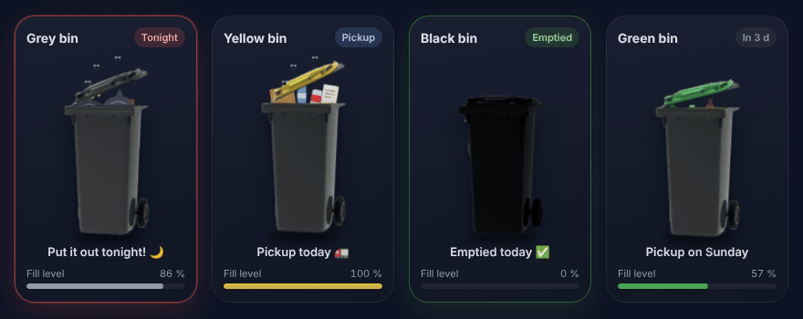
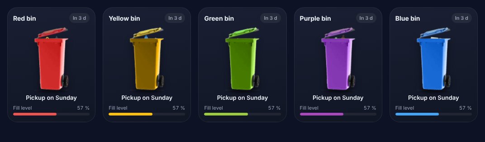
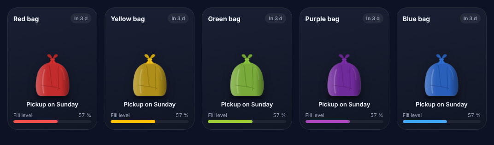

# 🗑️ Bin Collection Card


Animated Lovelace card for bin collection days: the bin fills up over the cycle, shakes the evening before pickup, hops on pickup day and sparkles once emptied.



## ✨ Features

| State | When | Animation |
|---|---|---|
| Normal | other days | contents rise, the lid lifts |
| Full (≥ 60 %) | end of the cycle | flies 🪰 and smells, bags wobble |
| **Tonight** | the day before pickup | the bin shakes, red border |
| **Pickup** | pickup day, before the truck | the bin hops |
| **Emptied** | pickup day, after the truck | sparkles ✨, green border |

- 8 colours: `red`, `yellow`, `green`, `purple`, `blue`, `grey`, `black`, `brown`
- **Fully coloured bin** (`full_color: true`) or coloured lid only
- **Rubbish bag** (`container: bag`) and **bulky waste** pile (`container: bulky`), or your own picture (`image`)
- Schedules: weekly, **every N weeks from a start date** (fortnightly, four-weekly…), even/odd weeks, once a month, seasonal months
- **Public holidays** from the [Holiday](https://www.home-assistant.io/integrations/holiday) integration, **next work day** from the [Workday](https://www.home-assistant.io/integrations/workday) integration
- Or read the date from an entity: date sensor, days-left sensor, `calendar`, [Waste Collection Schedule](https://github.com/mampfes/hacs_waste_collection_schedule)
- No dependencies, respects `prefers-reduced-motion`

## 📦 Installation

Requires **Home Assistant 2026.1** or later.

### HACS (recommended)
1. HACS → ⋮ → **Custom repositories** → add `https://github.com/Roving-Ronin/bin-collection-card`, type **Dashboard**.
2. Search for **Bin Collection Card** → Download.
3. Reload the browser (Ctrl + F5).

### Manual
1. Download `bin-collection-card.js` from the [latest release](https://github.com/Roving-Ronin/bin-collection-card/releases/latest) and copy it to `/config/www/`.
2. Settings → Dashboards → ⋮ → Resources → add `/local/bin-collection-card.js` (type *JavaScript module*).

## ⚙️ Configuration

Everything can be set from the visual editor. YAML examples:

### Weekly
```yaml
type: custom:bin-collection-card
bin: red
name: General waste
days: [tuesday, friday]   # or [1, 4] (0 = Monday … 6 = Sunday)
hour: 6                   # time the truck comes
```

### Australian bins
| Lid | `bin` | What goes in it | Shows when full |
|---|---|---|---|
| Red | `red` | General waste / landfill | rubbish bags |
| Yellow | `yellow` | Mixed recycling: glass bottles and jars, hard plastics, cans, paper and cardboard | recycling |
| Green | `green` | Food and garden organics (FOGO) | organics |
| Purple | `purple` | Glass recycling | glass bottles |
| Blue | `blue` | Paper and cardboard (mostly commercial) | paper and cardboard |

Councils differ: if yours uses a colour for something else, set `content` (`rubbish`, `recycling`, `organics`, `glass`, `paper`) and `name`.
```yaml
type: custom:bin-collection-card
bin: green
name: FOGO
start_date: 2026-11-04
every: 2
full_color: true
```

### Every N weeks from a start date (fortnightly recycling)
`start_date` is any date the bin was or will be collected. Pickups repeat every `every` weeks from it, forwards and backwards. The weekday comes from `start_date` unless you set `days`.
```yaml
type: custom:bin-collection-card
bin: yellow
start_date: 2026-11-04    # a known recycling Wednesday
every: 2                  # 1 = weekly, 2 = fortnightly, 3 or 4 = every 3 or 4 weeks (or: weekly, fortnightly)
```
Recycling and garden waste on alternate weeks? Give the second card a start date one week later.

### Public holidays
Add the **Holiday** integration (Settings → Devices & services → Add integration → Holiday) for your country and state. The card finds its calendar automatically, or you can pick it with `holiday_calendar`.

```yaml
type: custom:bin-collection-card
bin: red
days: [friday]
holidays: next_work_day
```

| `holidays` | A pickup that falls on a public holiday… | Needs |
|---|---|---|
| `none` (default) | is unaffected | — |
| `next_day` | moves to the next calendar day | Holiday |
| `next_work_day` | moves to the next working day | Holiday + Workday |
| `shift_week` | moves to the same day the following week (again if that is also a holiday) | Holiday |
| `shift_rest_of_week` | it and the rest of that week's pickups move one day later | Holiday |
| `cancel` | doesn't happen | Holiday |

`next_work_day` uses the calendar of the **Workday** integration, so your weekends, excluded days and added/removed holidays are respected. Without it, the card skips holidays and Sundays and shows a warning.

When a pickup is moved the card says so: “Pickup on Tuesday · moved (public holiday)”. Extra one-off dates can be added with `holiday_dates: ["2026-12-24"]`.

### Fully coloured bin
By default only the lid is coloured. With `full_color` the whole bin is (the wheel stays black), which is easier to read with several bins side by side.
```yaml
type: custom:bin-collection-card
bin: blue
days: [tuesday]
full_color: true
```


### Rubbish bag
A tied bag replaces the wheelie bin. It is flat at the start of the cycle and fills out until pickup day. The yellow bag is translucent, like recycling bags.
```yaml
type: custom:bin-collection-card
bin: yellow
container: bag
days: [thursday]
```


### Bulky waste
A pile of items (fridge, mattress, TV, tyre, box…) that grows until pickup day. `bin` is optional (grey meter by default).
```yaml
type: custom:bin-collection-card
container: bulky
month_week: 1        # first Wednesday of the month
days: [wednesday]
```

### Custom image
`image` replaces the drawing with your own picture (PNG or SVG, ideally on a transparent background), whatever the container.
```yaml
type: custom:bin-collection-card
container: bulky
image: /local/bulky.png
days: [wednesday]
month_week: 1
```

### Seasonal pickups
`months` limits pickups to some months (numbers or names). Out of season the card shows the next pickup date.
```yaml
type: custom:bin-collection-card
bin: green
name: Garden waste
days: [friday]
months: [9, 10, 11, 12, 1, 2, 3]
```

### Even / odd weeks
```yaml
type: custom:bin-collection-card
bin: yellow
days: [tuesday]
weeks: even        # ISO week numbers; the other bin: weeks: odd
```
For fortnightly pickups, `start_date` + `every: 2` is usually easier to match to your council calendar.

### Once a month
```yaml
type: custom:bin-collection-card
bin: blue
days: [tuesday]
month_week: 1        # 1st Tuesday of the month (2, 3, 4 or last)
```
```yaml
type: custom:bin-collection-card
bin: green
days: [saturday]
month_week: [2, 4]   # 2nd and 4th Saturdays
```
```yaml
type: custom:bin-collection-card
bin: green
month_day: 15        # the 15th of every month
```

### From an entity
```yaml
type: custom:bin-collection-card
bin: yellow
entity: sensor.recycling_pickup   # date, days left, calendar.*, Waste Collection Schedule…
interval: 14                      # days between pickups (for the fill level)
hour: 6
```

### From a calendar
One calendar for all bins? `calendar_filter` keeps only the events whose title contains this text (case-insensitive). The fill level then follows the real previous pickup, so `interval` isn't needed.
```yaml
type: custom:bin-collection-card
bin: yellow
entity: calendar.bin_collections
calendar_filter: Recycling      # or a list: [Recycling, Paper]
hour: 6
```
Is the event the day before pickup (“Put the bins out”)? Add `calendar_offset: 1`.

### Two cards side by side (sections view)
```yaml
type: grid
columns: 2
square: false
cards:
  - type: custom:bin-collection-card
    bin: red
    days: [1, 4]
    compact: true
    show_meter: false
    scale: 0.47
    headroom: 20
  - type: custom:bin-collection-card
    bin: yellow
    start_date: 2026-11-04
    every: 2
    compact: true
    show_meter: false
    scale: 0.47
    headroom: 20
```

### Options

| Option | Type | Default | Description |
|---|---|---|---|
| `bin` | text | **required** (except bulky) | `red`, `yellow`, `green`, `purple`, `blue`, `grey`, `black`, `brown` |
| `name` | text | from the colour | Card title |
| `days` | list | — | Pickup days: numbers (0 = Monday) or names (`tuesday`, `tue`). Required unless `start_date`, `month_day` or `entity` is set |
| `start_date` | date | — | A known pickup date; pickups repeat every `every` weeks from it. Overrides `weeks` |
| `every` | number / text | `1` | Weeks between pickups, counted from `start_date`: `1` / `weekly`, `2` / `fortnightly`, `3`, `4`… (the editor offers Weekly, Fortnightly, 3 Weekly, 4 Weekly) |
| `weeks` | text | all | `even` / `odd`: every other week by ISO week number |
| `month_week` | text / list | — | Only the `1`st, `2`nd, `3`rd, `4`th or `last` given weekday of the month; a list is possible: `[2, 4]` |
| `month_day` | number | — | Once a month on a fixed date (1–31; 31 = last day of the month). Replaces `days` |
| `months` | list | all year | Pickup months: numbers (`5` = May) or names. Combines with the options above |
| `holidays` | text | `none` | `none`, `next_day`, `next_work_day`, `shift_week`, `shift_rest_of_week`, `cancel` (see above) |
| `holiday_calendar` | entity | auto | Calendar of the Holiday integration |
| `workday_calendar` | entity | auto | Calendar of the Workday integration (for `next_work_day`) |
| `holiday_dates` | list | — | Extra dates treated as holidays, e.g. `["2026-12-24"]` |
| `entity` | entity | — | Source of the next pickup (see below). Click opens more-info |
| `hour` | number | `9` | Time the truck comes (decimals allowed: `6.5` = 6:30) |
| `calendar_filter` | text / list | — | With a `calendar.*` entity: only events whose title contains this text |
| `calendar_offset` | number | `0` | Days between the calendar event and the pickup (`1` if the event is the day before) |
| `interval` | number | `7` | Days between pickups (sensor entities only, for the fill level) |
| `content` | text | from the colour | What sticks out when full: `rubbish`, `recycling`, `glass`, `paper`, `organics`. Colours mean different things in different councils, so set this to match yours |
| `color` | CSS colour | from the colour | Meter colour |
| `full_color` | boolean | `false` | Colour the whole bin, not just the lid |
| `body_color` | CSS colour | from the colour | Bin colour with `full_color` |
| `container` | text | `wheelie_bin` | `wheelie_bin`, `bag` (rubbish bag) or `bulky` (pile of bulky waste) |
| `image` | URL | — | Your own picture instead of the drawing, e.g. `/local/bulky.png` |
| `lid_filter` / `body_filter` | CSS filter | — | Custom tint, e.g. `hue-rotate(90deg)` |
| `scale` | number | `0.62` | Size of the bin |
| `headroom` | px | `70` | Space above the bin (for the open lid) |
| `compact` | boolean | `false` | Smaller margins |
| `show_meter` | boolean | `true` | Fill meter |
| `show_status` | boolean | `true` | Text under the bin |
| `theme_background` | boolean | `false` | Use the HA theme card background |

### Supported entities
- **Waste Collection Schedule**: `daysTo` attribute
- `sensor` whose state is a **date** (`2026-10-20`), a **timestamp**, a **number of days** (`3`) or `today` / `tomorrow`
- `calendar.*`: events of the past and next 60 days, filterable by title (`calendar_filter`)
- `input_datetime` (with a date)

### Styling with card-mod / themes
CSS variables: `--bin-collection-card-background`, `--bin-collection-card-border-color`, `--bin-collection-card-text-color`, `--bin-collection-card-secondary-color`. State classes on `ha-card`: `eve` (tonight), `today` (pickup), `emptied`, `full`.

## 🛠️ Development

```bash
npm install
npm test          # scheduling logic + text keys
npm run build     # src/ → dist/bin-collection-card.js
npm run watch     # rebuild on change
npm run screenshots  # README images in images/ (needs Chrome and ffmpeg)
```
Edit files in `src/`, never `dist/` directly; commit the rebuilt `dist/bin-collection-card.js` with your change (CI checks it is up to date). **Releasing:** publish a GitHub release with a tag like `v1.1.0`. The tag is the version: the release workflow writes it into the card, builds and attaches `bin-collection-card.js` to the release, and commits the new version back to `main`. Nobody edits the version by hand.

## 📄 Licence
MIT. Based on [poubelle-card](https://github.com/skyrotter/ha-poubelle-card) by Nicolas (skyrotter), also MIT.
